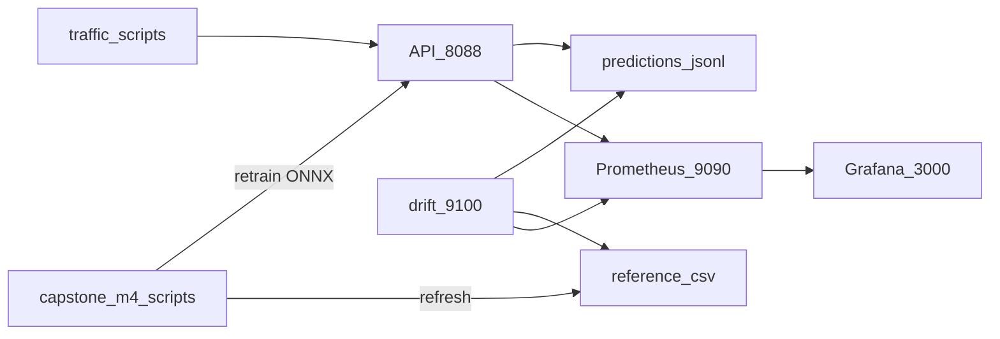

# Capstone M4 — Monitoring, drift alerts, demo retrain loop

Extends [Lab 7](../lab7-dryrun/) with **Steps 11–15**: react to drift, refresh the monitoring baseline, show recovery on Grafana/Evidently.

## Architecture

## Thresholds (Lab 7)

| Signal | Normal | Alert |
|--------|--------|-------|
| Feature drift score | &lt; ~0.1 | &gt; **0.25** |
| High-risk share | stable | &gt; **20%** |
| p95 latency | low | &gt; **200 ms** |
| Error rate | ~0 | &gt; **2%** |

## URLs

| Service | URL |
|---------|-----|
| API | http://localhost:8088/docs |
| Metrics (human) | http://localhost:8088/metrics/view |
| Prometheus | http://localhost:9090 |
| Grafana | http://localhost:3000 (admin / admin) |
| Drift metrics | http://localhost:9100/metrics |
| Evidently report | `lab7-dryrun/outputs/reports/drift_report.html` |

## Scripts

| Step | Script |
|------|--------|
| **11** | `python capstone-m4/retrain_trigger.py` — train on `input/*.csv`, export ONNX, copy to Lab 5 + Lab 7 API, log event, rebuild API container |
| **12** | Same script (default) — refresh `lab7-dryrun/outputs/data/reference.csv` from `input/` |
| **11 gate** | `python capstone-m4/check_drift_and_retrain.py` — if `cpu_temp_avg` drift ≥ 0.25, call retrain |
| **13–14** | `./capstone-m4/demo.sh` — normal → firmware → retrain → normal recovery |

## Teaching note (say this in the presentation)

- **Data drift** in the lab = live **inputs** differ from **`reference.csv`**, not “the training file broke.”
- **Retrain** here uses **`input/*.csv` (labeled)** to demo the **train → export → deploy** pipeline. It does **not** learn from **`predictions.jsonl`** alone (no failure labels in production logs).
- **Recovery** on the dashboard comes from **stopping +8°C traffic** and comparing **normal** recent logs to the baseline (Step 12 refresh keeps “normal” explicit).

## Logs

- `capstone-m4/logs/retrain_events.jsonl` — one JSON object per retrain (gitignored)
