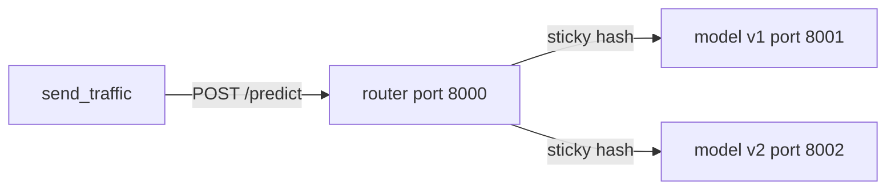

# Lab 6 — Edge model & canary rollout (`lab6_edge_canary.ipynb`)

**Status:** Implemented locally — run `python lab6/run_lab6.py` (no Colab notebook). Outputs: `lab6/outputs/`.

**Builds on:** [Lab 5](lab5_failure_model.ipynb) — laptop failure classifier (`failed_next_30d`), ONNX export, FastAPI, Docker.

---

## Goal

1. Train a **smaller edge model (v2)** that stays close to v1 quality.
2. Show **INT8 quantization** on a small neural network (not on trees).
3. Compare **size, accuracy, and latency** (including 1-thread “edge CPU”).
4. Run **v1 and v2** as separate services, fronted by a **canary router** (5% → 25% → 100%).
5. **Auto-rollback** when v2 is too slow or too error-prone.
6. Ship **Docker Compose** + zip for the laptop (Colab runs uvicorn in-process; no Docker in Colab).

---

## Use case & data

| Item | Detail |
|------|--------|
| Task | Binary: predict `failed_next_30d` from device telemetry |
| Input | All CSVs in `input/` (concatenate) |
| Columns | `device_id` (ID only), 6 features, `failed_next_30d` target |
| Colab | Upload `input/` → `/content/input`, or Drive + `INPUT_DIR` |
| Lab 5 v1 | `LAB5_DIR` = `/content/lab5_outputs` (or local `lab5_outputs/`) — use existing `model.onnx` if present |

### Fixed constants (single config cell)

```python
FEATURES = [
    "cpu_temp_avg", "battery_cycles", "device_age_months",
    "disk_errors", "crash_count_30d", "battery_health_pct",
]
TARGET = "failed_next_30d"
RANDOM_STATE = 42
OUTPUT_DIR = "/content/lab6_outputs"   # local: project_root/lab6_outputs

P95_LIMIT_MS = 200      # rollback if v2 p95 above this
ERROR_LIMIT_PCT = 1.0   # rollback if v2 error rate above this
MAX_F1_DROP = 0.02      # v2 OK if F1 >= v1_F1 - this
```

**Feature order** must match everywhere: training, ONNX, services, router.

### Stack

Python 3.11, pandas, numpy, scikit-learn, skl2onnx, onnx, onnxruntime (incl. `onnxruntime.quantization`), fastapi, uvicorn, httpx, requests, matplotlib.

---

## Output folder layout

```
lab6_outputs/
  models/v1/model.onnx, features.json
  models/v2/model.onnx, features.json
  models/v2_mlp_int8/model.onnx          # quantization demo (+ FP32 path in notebook)
  comparison.csv
  model_service/main.py, requirements.txt, Dockerfile
  router/main.py, requirements.txt, Dockerfile, router_config.json
  docker-compose.yml
  scripts/send_traffic.py
  logs/router_requests.jsonl
  logs/rollback_events.jsonl
  lab6_app.zip
```

---

## Runtime architecture



- **Sticky routing:** `md5(device_id) % 100 < v2_percent` → v2, else v1 (not Python `hash()`).
- **Rollback:** every 50 v2 requests, if v2 p95 > `P95_LIMIT_MS` or error rate > `ERROR_LIMIT_PCT` → set `v2_percent = 0`, log event.

---

## Notebook structure (8 steps)

Each step: markdown header + 2–3 plain-English lines, short code cells, computed results, print `Step N done`.

| Step | Title | Done when |
|------|--------|-----------|
| **1** | Load data and get v1 | `models/v1/model.onnx` exists; v1 test metrics printed |
| **2** | Build edge model v2 | v2 chosen with reason; parity < 1e-4; saved |
| **3** | Quantization demo (MLP FP32 → INT8) | FP32 vs INT8 table prints (quantize failure → log, continue) |
| **4** | Compare all models | `comparison.csv` + decision line (edge accept/reject) |
| **5** | Model service + v1/v2 side by side | Both `/health` 200; risky laptop on 8001 & 8002 |
| **6** | Canary router + auto-rollback | Router `/metrics`; 100% v1 at start (`v2_percent=0`) |
| **7** | Rollout 5→25→100 + bad release | Three passes; delay on v2 triggers rollback |
| **8** | Docker + summary + zip | `lab6_app.zip`; summary; all uvicorn stopped |

---

## Step details (implementation checklist)

### Step 1 — Load data and get v1

- [ ] Quiet pip install; config + optional Drive mount (commented).
- [ ] Load CSVs; validate columns; drop duplicates; median-fill numerics; failure rate.
- [ ] 80/20 stratified split, `random_state=42`.
- [ ] If `LAB5_DIR/model/model.onnx` exists → copy to `OUTPUT_DIR/models/v1/` + `features.json` (`version: v1`, `threshold: 0.5`, `onnx_input_name`).
- [ ] Else: `RandomForestClassifier(n_estimators=200, class_weight="balanced")` → skl2onnx `zipmap=False`.
- [ ] Evaluate v1 ONNX on test set: precision, recall, F1, AUC-ROC.

### Step 2 — Edge v2 (compressed trees)

- [ ] Markdown: trees don’t shrink with INT8; compress via fewer/shallower trees.
- [ ] Candidates: RF `(n_estimators, max_depth)` ∈ (100,10), (50,8), (30,6), (20,5).
- [ ] Export each ONNX; record size_kb, F1, AUC-ROC.
- [ ] Pick **smallest** with F1 ≥ v1_F1 − `MAX_F1_DROP`; else best F1 + warning.
- [ ] Save `models/v2/`; parity check vs sklearn.

### Step 3 — MLP quantization demo

- [ ] `Pipeline(StandardScaler, MLPClassifier(256,128, max_iter=300))` → ONNX FP32.
- [ ] `quantize_dynamic(..., weight_type=QInt8)` → `models/v2_mlp_int8/model.onnx`.
- [ ] Compare size, F1, AUC-ROC, 500× single-row latency; size ratio ~3–4×.
- [ ] try/except on quantize — print error, continue.

### Step 4 — Compare all models

- [ ] v1, v2, MLP FP32, MLP INT8: size_kb, F1, recall, AUC-ROC, p50/p95 (500 runs).
- [ ] Same with ORT **1 thread** → `p95_1thread_ms`.
- [ ] `comparison.csv`; bar charts (size, p95_1thread).
- [ ] Print: `v2 accepted / rejected for edge: <reason>`.

### Step 5 — Model service

- [ ] `model_service/main.py`: `MODEL_DIR`, `/health`, `/predict`, `EXTRA_DELAY_MS`, `FAIL_RATE`.
- [ ] requirements.txt + Dockerfile (3.11-slim, non-root, HEALTHCHECK).
- [ ] Background uvicorn: v1 `:8001`, v2 `:8002`; risky laptop on both.

### Step 6 — Router

- [ ] `router/main.py`: config JSON, sticky forward (httpx), jsonl logs, `/metrics`, `POST /config`, auto-rollback.
- [ ] Router on `:8000`, `v2_percent=0` initially.

### Step 7 — Rollout & failure drill

- [ ] `scripts/send_traffic.py` (--n, --url, --csv, real device_id).
- [ ] Loop 5%, 25%, 100% × 1000 requests; metrics table; PASS/FAIL.
- [ ] Plot v2 share; bad v2 (`EXTRA_DELAY_MS=300`) → rollback; restore v2.

### Step 8 — Laptop Docker

- [ ] `docker-compose.yml`: model-v1, model-v2 (1 CPU, 512m), router; volume mounts.
- [ ] Zip + Colab download; laptop commands markdown.
- [ ] Canary vs A/B (3 lines); final summary; stop processes.

---

## Repo implementation plan (after you approve)

| Task | Artifact |
|------|----------|
| 1 | `templates/lab6/` — service, router, scripts, compose |
| 2 | `generate_lab6_notebook.py` — assemble `lab6_edge_canary.ipynb` |
| 3 | Colab `%%writefile` / `write_lab_file()` dual paths (mirror Lab 5 local shim) |
| 4 | Local smoke: Steps 1–4 without servers; 5–7 with ports 8000–8002 |
| 5 | Update `.gitignore` for `lab6_outputs/` if needed |
| 6 | Git commit + push when you request |

**Not in scope (unless added later):** nginx, Kubernetes, Locust/k6, cloud monitoring.

---

## Laptop commands (preview — Step 8)

```bash
unzip lab6_app.zip && cd lab6_outputs
docker compose up -d --build
docker compose ps
docker stats --no-stream
curl -X POST localhost:8000/config -H "Content-Type: application/json" -d '{"v2_percent": 5}'
python scripts/send_traffic.py --url http://localhost:8000/predict --csv input/device_telemetry.csv --n 1000
curl localhost:8000/metrics
# repeat config for 25 and 100
docker compose down
```

---

## Approval

When this plan looks good, reply:

**“Implement Lab 6 per plan.md”**

We will build `lab6_edge_canary.ipynb` and templates without changing this file unless you ask for plan updates.
